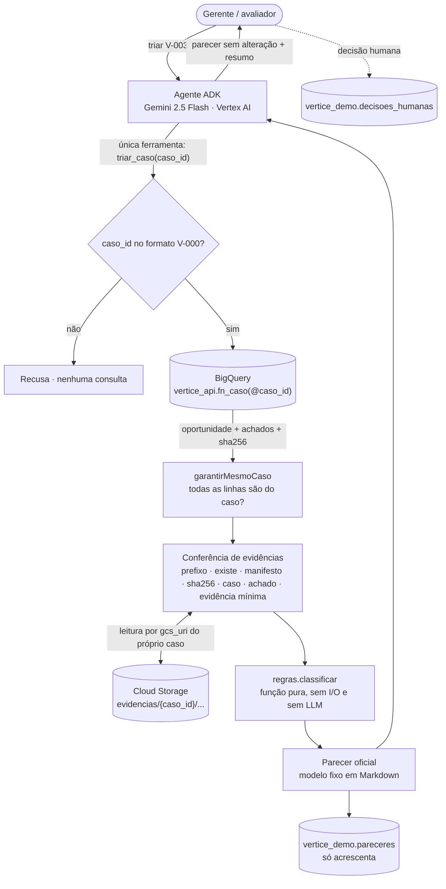

# Desenho técnico — Agente de triagem KYC/AML

Caso fictício Vértice Auditores & Consultores. Todos os dados e identificadores são sintéticos.

## 1. Visão geral

O agente faz a **triagem preliminar** de uma oportunidade: busca os dados do caso no BigQuery, confere as evidências no Cloud Storage, aplica a política (Anexo A) com regras determinísticas e emite um parecer rastreável. **Não decide** aceite, recusa ou início de trabalho: essas decisões são humanas e ficam registradas à parte.

Princípios que guiaram o desenho:

1. **O LLM não classifica.** Regras em código puro e testável; o Gemini só conversa e apresenta.
2. **Evidência por fato.** Todo motivo aponta para `evidencia_id` + `gcs_uri`, e o arquivo é conferido (existência, caso, hash) antes de virar fato.
3. **Isolamento por caso.** Um caso por consulta, por parâmetro; nenhum achado de outro caso chega ao parecer.
4. **Menor privilégio real.** O agente roda com uma conta de serviço que só enxerga uma função autorizada e um prefixo do bucket.
5. **Na dúvida, escala.** Fonte indisponível, homônimo ou evidência inconsistente geram PENDENTE com motivo, nunca LEVE.

## 2. Fluxo do agente



| Passo | Onde | Determinístico? |
|---|---|---|
| Interpretar o pedido e chamar a ferramenta | Gemini (ADK) | não |
| Validar `caso_id`, consultar, conferir, classificar, redigir o parecer, registrar | `src/` (TypeScript) | **sim** |
| Apresentar o parecer e resumir | Gemini (ADK) | não, mas não altera o registro |
| Aceitar, recusar, liberar início | pessoas | — |

O registro oficial (arquivo `pareceres/<caso>.md` e linha em `vertice_demo.pareceres`) é gerado **antes** de o LLM responder e não passa por ele.

### Ordem das regras (`src/regras.ts`)

1. **Completude:** as 4 fontes obrigatórias (`SANCOES`, `PEP`, `PROCESSOS`, `MIDIA`) precisam ter registro → senão `FONTE_AUSENTE`.
2. **Cada achado**, nesta ordem: evidência íntegra → consulta `CONCLUIDA` (senão `FONTE_INDISPONIVEL`) → até 12 meses (senão `CONSULTA_VENCIDA`) → nível conhecido → **identificador confirmado** (o identificador no snapshot é igual ao `cnpj` da oportunidade; senão `HOMONIMO`).
3. **Cadastro:** beneficiário final não identificado → ALTO; setor sensível → MODERADO; situação diferente de `ATIVA` → pendência.
4. **Resultado:** ALTO confirmado prevalece (mesmo com pendências, que são listadas); qualquer pendência → PENDENTE (com piso MODERADO se houver); MODERADO; senão LEVE.

| Resultado | Encaminhamento | Início do trabalho |
|---|---|---|
| LEVE | Gerente, para revisão e autorização | depende de autorização humana |
| MODERADO | Sócio responsável: ressalvas e monitoramento reforçado | depende de aprovação do sócio |
| ALTO | Comitê de Aceitação | **bloqueado** até decisão registrada |
| PENDENTE | Revisão humana (exceções) ou Pesquisa (consulta faltando) | **bloqueado** (não há parecer concluído) |

## 3. BigQuery

Região `southamerica-east1` (residência de dados no Brasil). Dois datasets:

| Dataset | Conteúdo | Quem acessa |
|---|---|---|
| `vertice_demo` | `oportunidades`, `achados`, `evidencias`, `pareceres`, `decisoes_humanas` | administradores; `fn_caso` (autorizada) lê; agente escreve **só** `pareceres` (permissão por tabela) |
| `vertice_api` | `fn_caso(p_caso_id)` — table function | agente (leitura) |

**Por que dois:** no BigQuery a leitura é concedida por dataset. Se a função ficasse junto das tabelas, a permissão para chamá-la também liberaria `SELECT *` nas tabelas brutas. Com a função em outro dataset e autorizada a ler `vertice_demo`, o agente só enxerga o que ela devolve: um caso por vez.

### Tabelas

| Tabela | Chave | Observações |
|---|---|---|
| `oportunidades` | `caso_id` | contrato original do desafio |
| `achados` | `(caso_id, achado_id)` | contrato original (9 colunas). `achado_id` se repete entre casos (`A-SAN`), por isso a chave é composta. FK para `oportunidades`. Clusterizada por `caso_id` |
| `evidencias` | `(caso_id, evidencia_id)` | manifesto de integridade: `gcs_uri` + `sha256` gravados na carga |
| `pareceres` | `parecer_id` | saída do agente; só recebe inserções; particionada por data, clusterizada por caso; `valido_ate` = 12 meses |
| `decisoes_humanas` | — | aceite/recusa/liberação; o agente não tem acesso |

PK/FK no BigQuery são `NOT ENFORCED`: documentam a intenção e ajudam o otimizador. A integridade é garantida pelo código (`garantirMesmoCaso`, conferência de evidências).

### Como um achado de outro caso não contamina o parecer

1. A consulta recebe `@caso_id` como **parâmetro** (sem concatenar texto).
2. O código interrompe a triagem se qualquer linha devolvida tiver outro `caso_id`.
3. O `gcs_uri` precisa estar sob `evidencias/{caso_id}/` (e sem `..`); fora disso, o objeto nem é lido.
4. O `caso_id` gravado **dentro** do snapshot precisa ser o do caso (é o que o V-006 demonstra).
5. Junções sempre por `caso_id`, nunca por razão social.

Armadilha coberta: o `LEFT JOIN` de uma oportunidade sem achados devolve uma linha com nulos. A regra trata isso como "consultas não realizadas" (PENDENTE), nunca como "nada encontrado" (LEVE).

## 4. Cloud Storage

```
gs://vertice-kyc-projeto-vertice-auditores/
  evidencias/{caso_id}/{evidencia_id}.json
```

O exemplo do desafio usava `evidencias/a-sancoes.json`, sem o caso no caminho. O desafio permite adaptar ("adapte os URIs e declare o mapeamento"); o caso no caminho permite isolar por prefixo, dar permissão por prefixo e detectar contaminação.

| Configuração | Motivo |
|---|---|
| Uniform bucket-level access | permissão só por IAM, sem ACL por objeto |
| Public access prevention | impede publicar evidência por engano |
| Versionamento | arquivo sobrescrito vira nova versão; o original não se perde |
| `southamerica-east1` | mesma região do BigQuery |

### Detecção de referência quebrada ou arquivo alterado

| Checagem (`src/evidencias.ts`) | Código quando falha | Caso |
|---|---|---|
| `gcs_uri` sob o prefixo do caso | `EVIDENCIA_FORA_DO_CASO` | teste |
| objeto existe (404) | `EVIDENCIA_NAO_ENCONTRADA` | V-008 |
| objeto consta no manifesto | `EVIDENCIA_NAO_REGISTRADA` | — |
| sha256 do conteúdo = manifesto | `EVIDENCIA_ALTERADA` | teste / demo |
| `caso_id` dentro do JSON = caso | `EVIDENCIA_DE_OUTRO_CASO` | V-006 |
| `evidencia_id` e fonte = achado | `EVIDENCIA_DIVERGENTE` | — |
| fonte, identificador ou URL, data/hora e trecho | `EVIDENCIA_INCOMPLETA` | — |

Erro 403 (permissão) **não** é tratado como arquivo ausente: interrompe a triagem, porque indica configuração errada, não evidência faltando.

O manifesto vem junto com o caso pela própria `fn_caso`, por isso o agente não precisa ler a tabela `evidencias`. Quem consegue sobrescrever um objeto no bucket não consegue alterar o manifesto, e vice-versa.

## 5. Identidade e permissões

| Identidade | Papel | Escopo |
|---|---|---|
| `kyc-agente@…` (conta de serviço do agente) | `roles/bigquery.jobUser` | projeto (rodar consultas) |
| | `READER` | **só** dataset `vertice_api` |
| | `roles/bigquery.dataEditor` | **só** tabela `vertice_demo.pareceres` |
| | `roles/storage.objectViewer` com condição `objects/evidencias/` | bucket (sem listar, sem escrever) |
| | `roles/aiplatform.user` | projeto (Gemini) |
| Desenvolvedor | `roles/iam.serviceAccountTokenCreator` | na `kyc-agente` (impersonation) |
| Revisores humanos | escrita em `decisoes_humanas` | tabela |

Verificado com a própria conta do agente: `fn_caso('V-003')` devolve só o V-003; `SELECT` em `vertice_demo.achados` → *Access Denied*; leitura de `evidencias/V-003/...` funciona; listar o bucket → negado; sha256 dos 30 objetos = manifesto.

**Sem chave JSON:** localmente o código roda como a conta do agente via `gcloud auth application-default login --impersonate-service-account=…`. Nenhuma credencial em disco ou no repositório.

## 6. Escolhas técnicas e trade-offs

| Decisão | Alternativa | Por que esta |
|---|---|---|
| Opção híbrida: BigQuery/GCS/IAM/Gemini reais, agente local | deploy no Agent Engine/Cloud Run | demonstra o que o desafio avalia (dados, evidências, privilégio) dentro do prazo; o deploy usaria a mesma conta de serviço |
| Regras em TypeScript puro | regras no LLM; regras em SQL | determinístico e testável; a conferência do GCS acontece fora do SQL, então a regra fica num lugar só |
| Uma ferramenta (`triar_caso`) | ferramentas separadas para BigQuery e GCS | o LLM não orquestra consultas; menos superfície de ataque |
| Table function autorizada | view autorizada; consulta direta | recebe o caso como parâmetro e devolve tudo de que a triagem precisa numa chamada |
| Homônimo detectado pelo snapshot | coluna nova `identificador_confirmado` | mantém o contrato original e tira a confirmação da evidência, não de uma marcação digitada |
| Parecer em modelo fixo | parecer redigido pelo Gemini | o registro oficial nunca depende do LLM |
| TypeScript no Node 24 (executa `.ts` direto) | Python | fluência do autor; o ADK tem SDK oficial em TS (`@google/adk`) |
| `gemini-2.5-flash` | `gemini-3-flash` | versão estável (GA) disponível no projeto; a 3 estava só em preview |
| `bloqueia_inicio` também para PENDENTE | só para ALTO | caso sem parecer concluído não deveria começar (ataca os 14% de início sob exceção) |

## 7. Armadilhas encontradas na implementação

1. **`bq load --replace` apaga PK/FK.** A carga que trunca a tabela reescreve o schema e descarta as constraints sem avisar. O `setup.sh` recria as tabelas de entrada e carrega sem `--replace`.
2. **`CREATE OR REPLACE` desautoriza a função.** A entrada continua aparecendo no dataset, mas o agente passa a receber *Access Denied*. O `setup.sh` remove e concede a autorização de novo a cada execução.
3. **Quebra de linha altera o hash.** O Git no Windows converte LF/CRLF no checkout, o que mudaria o sha256 das evidências e geraria falso `EVIDENCIA_ALTERADA`. O `.gitattributes` guarda os snapshots byte a byte.
